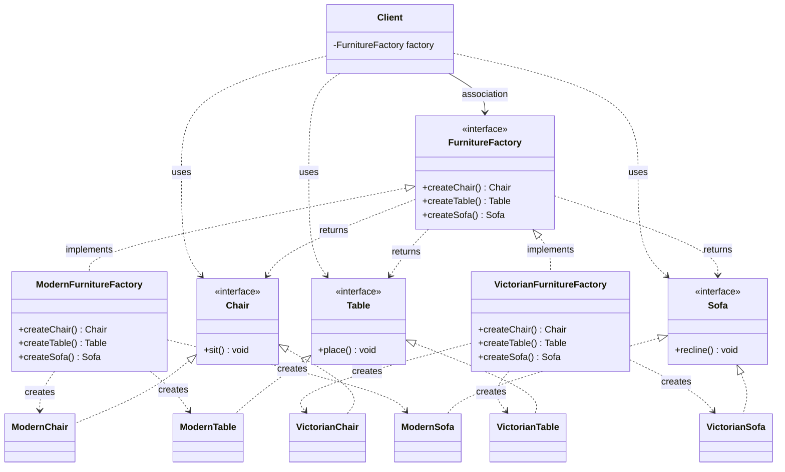

# Abstract Factory Pattern - Definitions, Where to Use & When to Use

## Definition

The **Abstract Factory Pattern** is a creational design pattern that provides an interface for creating families of related or dependent objects without specifying their concrete classes. It's essentially a "factory of factories."

### Simple Explanation

Instead of creating individual products (like chairs and tables), Abstract Factory creates entire families of related products (Modern furniture set OR Victorian furniture set) through a single interface.

## Key Concept

**Factory Pattern** → Creates ONE type of object
**Abstract Factory Pattern** → Creates FAMILIES of related objects

## Components

### 1. **Abstract Factory Interface**
Declares methods to create families of products.

```java
interface FurnitureFactory {
    Chair createChair();
    Table createTable();
    Sofa createSofa();
}
```

### 2. **Concrete Factories**
Implement the abstract factory to create specific product families.

```java
class ModernFurnitureFactory implements FurnitureFactory {
    @Override
    public Chair createChair() {
        return new ModernChair();
    }
    
    @Override
    public Table createTable() {
        return new ModernTable();
    }
    
    @Override
    public Sofa createSofa() {
        return new ModernSofa();
    }
}

class VictorianFurnitureFactory implements FurnitureFactory {
    @Override
    public Chair createChair() {
        return new VictorianChair();
    }
    
    @Override
    public Table createTable() {
        return new VictorianTable();
    }
    
    @Override
    public Sofa createSofa() {
        return new VictorianSofa();
    }
}
```

### 3. **Abstract Product Interface**
Defines the interface for product families.

```java
interface Chair {
    void sit();
}

interface Table {
    void place();
}

interface Sofa {
    void recline();
}
```

### 4. **Concrete Products**
Implements specific products for each family.

```java
// Modern furniture
class ModernChair implements Chair {
    @Override
    public void sit() {
        System.out.println("Sitting on modern chair");
    }
}

// Victorian furniture
class VictorianChair implements Chair {
    @Override
    public void sit() {
        System.out.println("Sitting on Victorian chair");
    }
}
```

## Usage Example

```java
// Client code
FurnitureFactory factory;

// Choose furniture style
if (style.equals("modern")) {
    factory = new ModernFurnitureFactory();
} else {
    factory = new VictorianFurnitureFactory();
}

// Create entire furniture set
Chair chair = factory.createChair();
Table table = factory.createTable();
Sofa sofa = factory.createSofa();

// Use them
chair.sit();
table.place();
sofa.recline();
```

## Class Diagram



### Relationships

| From → To | Relationship | UML Symbol | Why (evidence in code) |
|-----------|--------------|------------|------------------------|
| `ModernFurnitureFactory`, `VictorianFurnitureFactory` → `FurnitureFactory` | **Realization** | Dashed line + hollow triangle `- - -▷` | `class ModernFurnitureFactory implements FurnitureFactory` |
| `ModernChair`, `VictorianChair` → `Chair` (same for `Table`, `Sofa`) | **Realization** | Dashed line + hollow triangle `- - -▷` | `class ModernChair implements Chair` |
| Concrete factory → its concrete products | **Dependency** ("creates") | Dashed arrow `- - ->` | `return new ModernChair();` — creates and returns, never stores |
| `FurnitureFactory` → `Chair`, `Table`, `Sofa` | **Dependency** | Dashed arrow `- - ->` | Product interfaces are the **return types** of the factory methods |
| `Client` → `FurnitureFactory` | **Association** | Solid arrow `───>` | The client holds a `FurnitureFactory factory` reference and uses it for its whole job |
| `Client` → `Chair`, `Table`, `Sofa` | **Dependency** | Dashed arrow `- - ->` | Products are local variables the client calls `sit()` / `place()` / `recline()` on |

> **Key point:** The client only has lines to **interfaces** (`FurnitureFactory`, `Chair`, `Table`, `Sofa`) — never to `ModernChair` or `VictorianFurnitureFactory`. Swapping the whole family = swapping one factory object.

## Factory Pattern vs Abstract Factory Pattern

| Aspect | Factory Pattern | Abstract Factory Pattern |
|--------|-----------------|------------------------|
| **Purpose** | Creates ONE product type | Creates FAMILIES of products |
| **Returns** | Single concrete class | Multiple related products |
| **Complexity** | Simple, one method | Complex, multiple methods |
| **Use Case** | Transport types (Air, Road) | UI themes (Modern, Dark, Light) |
| **Products** | Independent | Related/Dependent |
| **Example** | LogisticsFactory | FurnitureFactory |

## WHERE TO USE Abstract Factory

### 1. **UI Themes/Styles**
```
Theme Factory
├─ LightTheme → Button, Label, TextField (light versions)
└─ DarkTheme → Button, Label, TextField (dark versions)
```

### 2. **Database Drivers**
```
DatabaseFactory
├─ MySQLFactory → Connection, Statement, ResultSet (MySQL versions)
└─ PostgreSQLFactory → Connection, Statement, ResultSet (PostgreSQL versions)
```

### 3. **Cross-Platform UI Libraries**
```
UIFactory
├─ WindowsUIFactory → Window, Button, ScrollBar (Windows style)
├─ MacUIFactory → Window, Button, ScrollBar (Mac style)
└─ LinuxUIFactory → Window, Button, ScrollBar (Linux style)
```

### 4. **Payment Systems**
```
PaymentFactory
├─ CreditCardFactory → Payment, Validation, Encryption
├─ PayPalFactory → Payment, Validation, Encryption
└─ GooglePayFactory → Payment, Validation, Encryption
```

### 5. **Document Types**
```
DocumentFactory
├─ PDFFactory → Reader, Writer, Converter
└─ WordFactory → Reader, Writer, Converter
```

## WHEN TO USE Abstract Factory

### ✅ USE Abstract Factory When:

1. **System has multiple families of products**
   - Different UI themes with matching components
   - Multiple database systems with same interfaces

2. **Products in a family are designed to work together**
   - Buttons and Labels should match in style
   - Database operations should be consistent

3. **You want to isolate product creation from usage**
   - Client code doesn't know which concrete products are created
   - Easy to switch between product families

4. **You need to maintain product family consistency**
   - Ensures all products come from the same family
   - Prevents mixing Modern chairs with Victorian tables

5. **Product variants exist across multiple dimensions**
   - UI elements across multiple themes
   - Database operations across multiple systems

6. **Extensibility is important**
   - Adding new product families doesn't change existing code
   - Open/Closed Principle

### ❌ DON'T USE Abstract Factory When:

1. **System has only ONE family of products**
   - Use Factory Pattern instead (simpler)

2. **Products are independent/unrelated**
   - They don't need to work together
   - Use regular Factory Pattern

3. **Few product types**
   - Complexity outweighs benefits
   - Simple constructors are better

4. **Products rarely change**
   - No need for the abstraction layer

## Real-World Examples

### 1. **Swing (Java UI Library)**
```java
UIFactory → LookAndFeelFactory
├─ MetalLookAndFeel → Button, TextBox, Slider
├─ WindowsLookAndFeel → Button, TextBox, Slider
└─ MacLookAndFeel → Button, TextBox, Slider
```

### 2. **Android Layout Themes**
```
ThemeFactory
├─ Material3Factory → AppBar, FAB, Card
├─ MaterialFactory → AppBar, FAB, Card
└─ LegacyFactory → AppBar, FAB, Card
```

### 3. **Spring Framework**
```
DataSourceFactory
├─ HikariDataSourceFactory → Connection Pool, Connection
└─ C3P0DataSourceFactory → Connection Pool, Connection
```

### 4. **JDBC (Database)**
```
DriverFactory
├─ MySQLDriver → Connection, Statement, ResultSet
├─ PostgreSQLDriver → Connection, Statement, ResultSet
└─ OracleDriver → Connection, Statement, ResultSet
```

## Advantages

| Advantage | Explanation |
|-----------|-------------|
| **Consistency** | Ensures products from same family are used together |
| **Isolation** | Client code doesn't depend on concrete classes |
| **Scalability** | Easy to add new product families |
| **Maintainability** | Changes to one family don't affect others |
| **Flexibility** | Switch between families easily |
| **Open/Closed** | Open for extension, closed for modification |

## Disadvantages

| Disadvantage | Explanation |
|--------------|-------------|
| **Complexity** | More classes and interfaces than Factory Pattern |
| **Overkill** | For simple systems with few products |
| **Adding Products** | Requires changing abstract factory interface |
| **Learning Curve** | More complex to understand initially |

## Comparison: With vs Without Abstract Factory

### ❌ WITHOUT Abstract Factory
```java
// Client code tightly coupled to concrete classes
if (theme.equals("modern")) {
    ModernButton button = new ModernButton();
    ModernTable table = new ModernTable();
    ModernChair chair = new ModernChair();
} else if (theme.equals("victorian")) {
    VictorianButton button = new VictorianButton();
    VictorianTable table = new VictorianTable();
    VictorianChair chair = new VictorianChair();
}
// Hard to add new themes - must change everywhere
```

### ✅ WITH Abstract Factory
```java
// Client code uses factory interface
FurnitureFactory factory = getFactory(theme);
Button button = factory.createButton();
Table table = factory.createTable();
Chair chair = factory.createChair();
// Easy to add new themes - just implement factory
```

## Step-by-Step Implementation

1. **Create Abstract Factory Interface**
   ```java
   interface FurnitureFactory { ... }
   ```

2. **Create Concrete Factories**
   ```java
   class ModernFurnitureFactory implements FurnitureFactory { ... }
   class VictorianFurnitureFactory implements FurnitureFactory { ... }
   ```

3. **Create Abstract Product Interfaces**
   ```java
   interface Chair { ... }
   interface Table { ... }
   ```

4. **Create Concrete Products**
   ```java
   class ModernChair implements Chair { ... }
   class VictorianChair implements Chair { ... }
   ```

5. **Use in Client Code**
   ```java
   FurnitureFactory factory = new ModernFurnitureFactory();
   Chair chair = factory.createChair();
   ```

## Decision Tree: Which Pattern to Use?

```
Need to create objects?
│
├─ Single product type?
│  └─ YES → Use Factory Pattern
│
├─ Related product families?
│  └─ YES → Use Abstract Factory Pattern
│
├─ Complex step-by-step construction?
│  └─ YES → Use Builder Pattern
│
└─ Only one instance needed?
   └─ YES → Use Singleton Pattern
```

## Key Takeaways

✨ **Abstract Factory** = "Factory of Factories"
- Creates families of related objects
- Ensures product consistency
- Decouples client from concrete classes
- Perfect for multi-variant systems
- More complex than Factory Pattern 