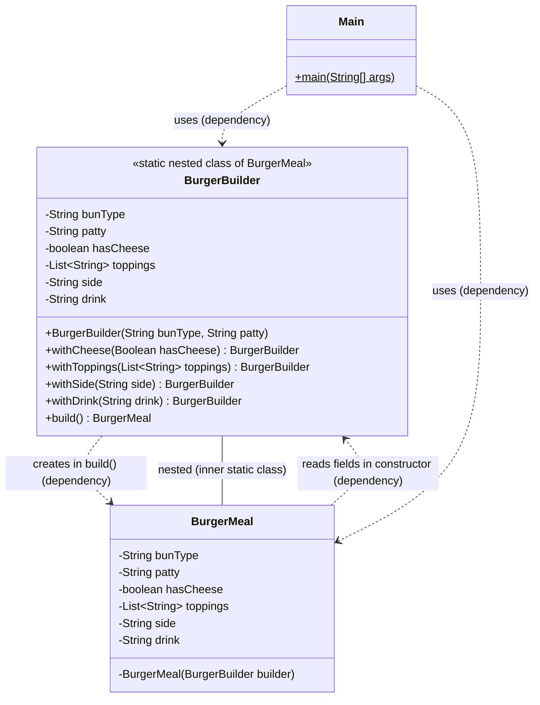

# Builder Pattern - Definitions & Important Notes

## Definition

The **Builder Pattern** is a creational design pattern that separates the construction of a complex object from its representation. It allows building objects step-by-step using a fluent interface (method chaining) instead of passing many parameters to the constructor.

### Problem It Solves

When creating objects with many optional and required parameters, constructor overloading becomes messy:

```java
// Without Builder - Constructor hell
Burger(String bun, String patty, boolean cheese, List toppings, String side, String drink)
Burger(String bun, String patty, boolean cheese)
Burger(String bun, String patty)
// Too many constructors!
```

## Key Components

### 1. **Product Class** (BurgerMeal)
The complex object being constructed with multiple fields.

```java
class BurgerMeal {
    private final String bunType;      // Required
    private final String patty;        // Required
    private final boolean hasCheese;   // Optional
    private final List<String> toppings; // Optional
    private final String side;         // Optional
    private final String drink;        // Optional
}
```

### 2. **Builder Class** (BurgerBuilder)
Inner static class that constructs the product step-by-step.

```java
public static class BurgerBuilder {
    // Constructor for required parameters
    public BurgerBuilder(String bunType, String patty) { ... }
    
    // Setter methods for optional parameters (return 'this')
    public BurgerBuilder withCheese(Boolean hasCheese) { ... }
    public BurgerBuilder withToppings(List<String> toppings) { ... }
    
    // Final method to build and return the product
    public BurgerMeal build() { ... }
}
```

### 3. **Private Constructor**
The product's constructor is private to prevent direct instantiation.

```java
private BurgerMeal(BurgerBuilder builder) {
    this.bunType = builder.bunType;
    this.patty = builder.patty;
    // ... copy all fields
}
```

## Usage Pattern

```java
BurgerMeal meal = new BurgerMeal.BurgerBuilder("Wheat", "Beef")
    .withCheese(true)
    .withToppings(Arrays.asList("Lettuce", "Tomato"))
    .withSide("Fries")
    .withDrink("Coke")
    .build();
```

## Class Diagram



### Relationships

| From → To | Relationship | UML Symbol | Why (evidence in code) |
|-----------|--------------|------------|------------------------|
| `BurgerMeal` → `BurgerBuilder` | **Nesting** (inner class) | Circle-plus `⊕──` (Mermaid can't draw this, so it's shown as a plain line labelled "nested") | `BurgerBuilder` is declared as `public static class` **inside** `BurgerMeal`, so it can call the private constructor |
| `BurgerBuilder` → `BurgerMeal` | **Dependency** ("creates") | Dashed arrow `- - ->` | `build()` does `new BurgerMeal(this)` and returns it — the builder **never stores** a `BurgerMeal` field |
| `BurgerMeal` → `BurgerBuilder` | **Dependency** ("uses") | Dashed arrow `- - ->` | The constructor takes `BurgerBuilder` as a **parameter** and copies its fields; it doesn't keep a reference |
| `Main` → `BurgerBuilder`, `BurgerMeal` | **Dependency** | Dashed arrow `- - ->` | Only used as local variables inside `main()` |

> **Why not association/composition?** Neither class keeps a field pointing to the other. The builder only exists briefly to make the meal, then gets thrown away. "Uses temporarily" = **dependency**.

## Important Keywords & Their Purpose

### `final` (Fields)
```java
private final String bunType;
```
- Makes fields **immutable** after object creation
- Prevents accidental modifications
- Thread-safe
- Ensures object stays exactly as built

### `private` (Constructor)
```java
private BurgerMeal(BurgerBuilder builder) { ... }
```
- Forces users to use the Builder class
- Prevents direct instantiation
- Ensures objects are properly constructed

### `public static` (Builder Class)
```java
public static class BurgerBuilder { ... }
```
- `public` = Accessible from outside for clients to use
- `static` = Belongs to the class, not instances
- Accessed as `new BurgerMeal.BurgerBuilder(...)`

### `return this` (Setter Methods)
```java
public BurgerBuilder withCheese(Boolean hasCheese) {
    this.hasCheese = hasCheese;
    return this;  // Enables method chaining
}
```
- Returns the builder itself
- Allows fluent interface (method chaining)
- Makes code readable and clean

## Advantages

| Advantage | Explanation |
|-----------|-------------|
| **Readability** | Clear, fluent syntax shows what's being set |
| **Flexibility** | Add/remove optional parameters easily |
| **Immutability** | Objects become immutable after creation |
| **Thread-safe** | No race conditions with final fields |
| **Maintainability** | Easy to add new optional parameters |
| **No Null Params** | Only set what's needed, no null checks |

## Disadvantages

| Disadvantage | Explanation |
|--------------|-------------|
| **Code Verbosity** | More code than simple constructors |
| **Performance** | Creates extra builder object |
| **Learning Curve** | Not as intuitive as constructors for beginners |

## Comparison: With vs Without Builder

### ❌ Without Builder
```java
// Multiple constructors (constructor overloading)
BurgerMeal meal1 = new BurgerMeal("Wheat", "Beef");
BurgerMeal meal2 = new BurgerMeal("Wheat", "Beef", true);
BurgerMeal meal3 = new BurgerMeal("Wheat", "Beef", true, toppings);
BurgerMeal meal4 = new BurgerMeal("Wheat", "Beef", true, toppings, "Fries");
// Hard to remember which parameter is which
```

### ✅ With Builder
```java
// Clear and self-documenting
BurgerMeal meal = new BurgerMeal.BurgerBuilder("Wheat", "Beef")
    .withCheese(true)
    .withToppings(toppings)
    .withSide("Fries")
    .build();
```

## Real-World Usage

The Builder Pattern is used in popular libraries:

- **StringBuilder** in Java
- **ProcessBuilder** in Java
- **okhttp** - HTTP client
- **Retrofit** - REST client
- **Google Guava** - Collections builder
- **Lombok** - @Builder annotation
- **Amazon Cart** - Amazon cart builder have lot of options

## Best Practices

1. **Required fields in constructor** - Only mandatory parameters
2. **Optional fields as setter methods** - Use `with*` naming convention
3. **Return `this` for chaining** - Enables fluent interface
4. **Private product constructor** - Force using builder
5. **Make product immutable** - Use `final` fields
6. **Validation in `build()` method** - Validate complete object before returning

## Example Validation in build()

```java
public BurgerMeal build() {
    if (bunType == null || patty == null) {
        throw new IllegalStateException("Required fields missing");
    }
    return new BurgerMeal(this);
}
```

## When to Use Builder Pattern

✅ Use when:
- Object has many optional fields (3+)
- Immutability is important
- Complex initialization logic
- Object creation with multiple steps

❌ Don't use when:
- Object has only 1-2 required fields
- Mutability is preferred
- Constructor is simple enough
