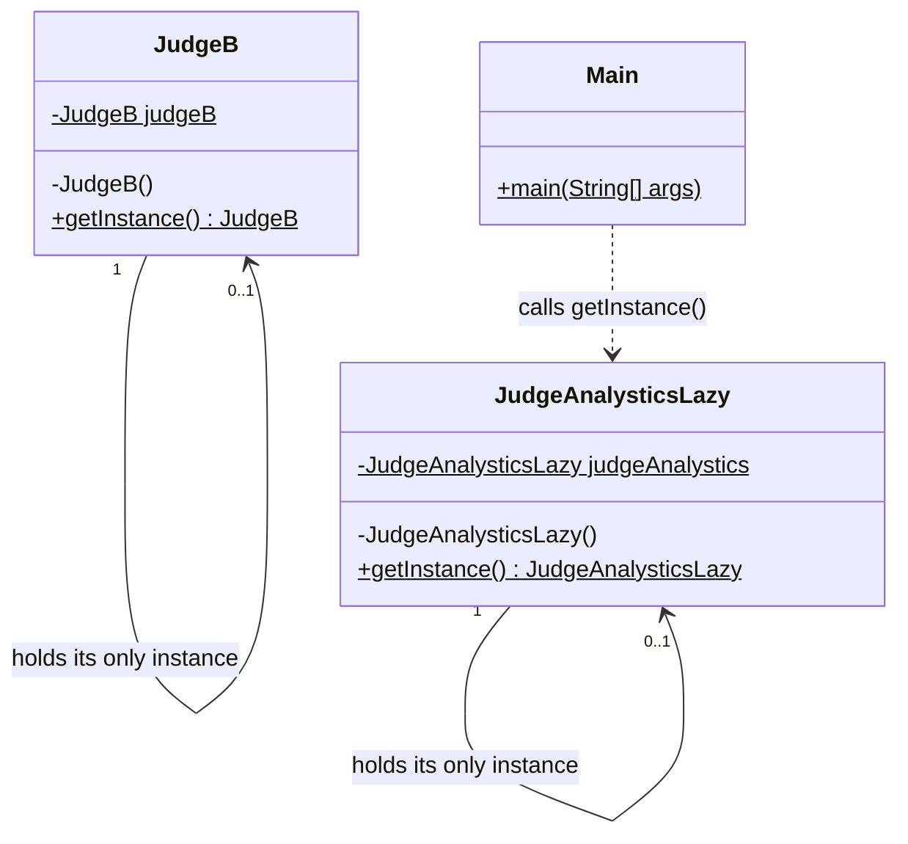

# Singleton Pattern - Complete Guide

## What is the Singleton Pattern?

The **Singleton Pattern** is a creational design pattern that ensures a class has **only one instance** in the whole application, and provides a **single global access point** to that instance.

In simpler terms: No matter how many times or from how many places you ask for the object, you always get back **the exact same object**.

---

## Problem It Solves

### The Problem Without Singleton Pattern

Imagine a `JudgeAnalystics` class that collects statistics (e.g. how many submissions were judged). If anyone can call `new`, every part of the code gets its own copy:

```java
JudgeAnalystics a1 = new JudgeAnalystics();
JudgeAnalystics a2 = new JudgeAnalystics();
// a1 != a2 → two separate counters, data is split and inconsistent
```

**Problems with this approach:**
- **Inconsistent shared state**: Each object keeps its own data, so counts/configs drift apart
- **Wasted resources**: Expensive objects (DB connection pools, loggers, caches) get created again and again
- **No single source of truth**: There's no guarantee everyone is reading/writing the same data

### Solution: Singleton Pattern

1. Make the constructor **`private`** → nobody outside can call `new`
2. Keep the one instance in a **`private static`** field of the class itself
3. Expose a **`public static getInstance()`** method that always returns that same instance

---

## Code Structure & Explanation

`Main.java` shows **4 ways** to implement a Singleton, from simplest to most production-ready.

### 1. Eager Initialization - `JudgeAnalystics`

```java
class JudgeAnalystics{
    private static final JudgeAnalystics judgeAnalystics = new JudgeAnalystics();

    private JudgeAnalystics() {
    }

    public static JudgeAnalystics getInstance(){
        return judgeAnalystics;
    }
}
```

**What it does:**
- **Creates the instance when the class is loaded** (eagerly), not when it's first needed
- **`private static final`**: one copy for the whole class (`static`), can never be reassigned (`final`), hidden from outside (`private`)
- **`private` constructor**: blocks `new JudgeAnalystics()` from any other class
- **`getInstance()`** just returns the already-built object

**Thread safety:** ✅ **Thread-safe** — the JVM guarantees class loading (and static field initialization) happens exactly once, even with many threads.

**Downside:** The object is created even if the program never uses it. Bad if construction is expensive.

---

### 2. Lazy Initialization - `JudgeAnalysticsLazy` (NOT thread-safe)

```java
class JudgeAnalysticsLazy{
    private static JudgeAnalysticsLazy judgeAnalystics;

    private JudgeAnalysticsLazy(){
    }

    public static JudgeAnalysticsLazy getInstance(){
        if(judgeAnalystics == null){
            judgeAnalystics = new JudgeAnalysticsLazy();
        }
        return judgeAnalystics;
    }
}
```

**What it does:**
- **Creates the instance only on the first `getInstance()` call** (lazily, at execution time)
- Every later call skips the `if` and returns the stored instance

**Thread safety:** ❌ **NOT thread-safe.** Race condition:

```
Thread 1: checks judgeAnalystics == null → true
Thread 2: checks judgeAnalystics == null → true   (Thread 1 hasn't assigned yet)
Thread 1: creates instance #1
Thread 2: creates instance #2   ← two instances! Singleton broken
```

**Problem solved:** Avoids creating the object until it's really needed. Fine for single-threaded programs only.

---

### 3. Synchronized Method - `JudgeA` (thread-safe, but slow)

```java
class JudgeA{
    private static JudgeA judgeA;

    private JudgeA(){
    }

    public static synchronized JudgeA getInstance(){
        if(judgeA == null){
            judgeA = new JudgeA();
        }
        return judgeA;
    }
}
```

**What it does:**
- **`synchronized`** on the method means only **one thread at a time** can run `getInstance()`
- This removes the race condition from approach #2

**Thread safety:** ✅ **Thread-safe**

**Downside:** Locking is only needed **once** (the first creation), but this code locks on **every** call — forever. Under heavy load, threads queue up just to read an object that already exists.

---

### 4. Double-Checked Locking - `JudgeB` (thread-safe and fast)

```java
class JudgeB{
    private static volatile JudgeB judgeB;

    private JudgeB(){
    }

    public static JudgeB getInstance(){
        if(judgeB == null){                    // 1st check (no lock)
            synchronized (JudgeB.class) {      // lock only if needed
                if(judgeB == null){            // 2nd check (with lock)
                    judgeB = new JudgeB();
                }
            }
        }
        return judgeB;
    }
}
```

**What it does:**
- **1st check (outside the lock)**: if the instance already exists, return it immediately — **no locking cost** on normal calls
- **`synchronized (JudgeB.class)` block**: only entered while the instance is still `null` (i.e. at the very start)
- **2nd check (inside the lock)**: another thread may have created the instance while this thread was waiting for the lock, so check again
- **`volatile`**: required for correctness — see below

**Why `volatile` is needed:**
`judgeB = new JudgeB()` is actually 3 steps: (1) allocate memory, (2) run the constructor, (3) assign the reference. The CPU/JIT may **reorder** these to 1 → 3 → 2. Without `volatile`, another thread could see `judgeB != null` and use a **half-constructed object**. `volatile` forbids that reordering and makes the write visible to all threads immediately.

**Thread safety:** ✅ **Thread-safe**, with locking only during first creation.

> Note: the comment above `getInstance()` in `Main.java` says "synchronized methode", but this version uses a **synchronized block**, not a synchronized method — that's the whole difference from `JudgeA`.

---

### 5. Usage - Proving It's the Same Object

```java
public class Main {
    public static void main(String[] args) {
        System.out.println("Singleton Pattern Example");
        JudgeAnalysticsLazy ja1 = JudgeAnalysticsLazy.getInstance();
        JudgeAnalysticsLazy ja2 = JudgeAnalysticsLazy.getInstance();
        System.out.println(ja1);
        System.out.println(ja2);
    }
}
```

**What happens step by step:**

1. First `getInstance()` → field is `null` → creates the object and stores it
2. Second `getInstance()` → field is not `null` → returns the **same** stored object
3. Printing both shows the same `ClassName@hashCode`

**Output** (the hash part changes every run, but both lines always match):
```
Singleton Pattern Example
JudgeAnalysticsLazy@6b419da
JudgeAnalysticsLazy@6b419da
```

You could also check `System.out.println(ja1 == ja2);` → `true`.

**Problem solved:** Two separate calls from client code return one shared object.

---

## Comparison of the 4 Implementations

| Class | Approach | Lazy? | Thread-safe? | Performance | Use when |
|-------|----------|-------|--------------|-------------|----------|
| `JudgeAnalystics` | Eager initialization | ❌ | ✅ | Fast | Object is cheap / always needed |
| `JudgeAnalysticsLazy` | Lazy initialization | ✅ | ❌ | Fast | Single-threaded code only |
| `JudgeA` | Synchronized method | ✅ | ✅ | Slow (locks every call) | Low traffic, simplicity matters |
| `JudgeB` | Double-checked locking + `volatile` | ✅ | ✅ | Fast | Multi-threaded, expensive object |

### Bonus: Two Other Common Ways (not in `Main.java`)

```java
// Bill Pugh / static holder — lazy + thread-safe, no locks, no volatile
class JudgeHolder{
    private JudgeHolder(){}
    private static class Holder{
        private static final JudgeHolder INSTANCE = new JudgeHolder();
    }
    public static JudgeHolder getInstance(){
        return Holder.INSTANCE;   // Holder class loads only on first call
    }
}

// Enum singleton — thread-safe, and safe against reflection & serialization
enum JudgeEnum{
    INSTANCE;
    public void record(){ ... }
}
```

---

## Singleton Pattern Roles (Mapped to This Code)

| Role | In This Code |
|------|---------------|
| **Singleton** (the one-instance class) | `JudgeAnalystics`, `JudgeAnalysticsLazy`, `JudgeA`, `JudgeB` |
| **Static instance field** | `judgeAnalystics`, `judgeA`, `judgeB` |
| **Global access point** | `getInstance()` |
| **Client** | `Main` |

---

## Class Diagram

All four classes have the same shape, so the diagram shows the double-checked locking version (`JudgeB`) plus the one `Main` actually uses (`JudgeAnalysticsLazy`).



(`$` = static, `-` = private, `+` = public)

### Relationships

| From → To | Relationship | UML Symbol | Why (evidence in code) |
|-----------|--------------|------------|------------------------|
| `JudgeB` → `JudgeB` (same for all 4 classes) | **Self-association** | Solid arrow looping back to the same class `───>` | The class has a `private static` field **of its own type** (`private static volatile JudgeB judgeB`). Multiplicity `0..1`: it's `null` before the first call (lazy versions), then exactly one |
| `Main` → `JudgeAnalysticsLazy` | **Dependency** ("uses-a") | Dashed arrow `- - ->` | `Main` only calls the static `getInstance()` and stores the result in **local variables** `ja1`, `ja2` |

> **Why self-association and not composition?** The class does create the instance itself, but the field is `static`, so it belongs to the **class**, not to any one object. UML shows that as a static (underlined) attribute plus a self-association. There's no separate "whole" and "part", so composition doesn't fit.

---

## Important Keywords & Their Purpose

| Keyword | Where | Purpose |
|---------|-------|---------|
| `private` constructor | `private JudgeB(){}` | Stops anyone outside the class from calling `new` |
| `static` field | `private static JudgeB judgeB` | One shared slot for the whole class, not per object |
| `static` method | `public static JudgeB getInstance()` | Callable without an object (you can't have an object yet!) |
| `final` | `private static final JudgeAnalystics ...` | Eager version: the reference can never be replaced |
| `synchronized` | method (`JudgeA`) or block (`JudgeB`) | Only one thread at a time creates the instance |
| `volatile` | `private static volatile JudgeB judgeB` | Prevents half-constructed objects being seen by other threads |

---

## Advantages

| Advantage | Explanation |
|-----------|-------------|
| **Exactly one instance** | Guaranteed shared state, e.g. one analytics counter for the whole app |
| **Global access point** | Any class can call `getInstance()` without passing the object around |
| **Saves resources** | Expensive objects (DB pool, cache, logger) are created once |
| **Lazy creation possible** | Lazy versions delay creation until it's actually needed |

## Disadvantages

| Disadvantage | Explanation |
|--------------|-------------|
| **Hidden global state** | Any code can change it from anywhere, which makes bugs hard to trace |
| **Hard to unit test** | You can't easily replace it with a mock, and state leaks between tests |
| **Violates Single Responsibility** | The class manages its own lifecycle *and* does its real job |
| **Tight coupling** | Callers depend on the concrete class via `JudgeB.getInstance()` instead of an interface |
| **Thread-safety pitfalls** | Easy to get wrong (see `JudgeAnalysticsLazy`), and `volatile` is easy to forget |
| **Can be broken** | Reflection (`setAccessible(true)`), serialization, and cloning can create a second instance (the **enum** version prevents this) |

---

## Real-World Applications

- **Java runtime**: `Runtime.getRuntime()` returns the one `Runtime` object for the JVM
- **Logging**: a single logger/log manager shared by the whole app
- **Configuration**: one `AppConfig` object loaded once from a file
- **Connection pools / caches**: one shared pool or cache instance
- **Spring framework**: beans are **singleton-scoped by default** (one per container, managed by Spring instead of `getInstance()`)

---

## When to Use Singleton Pattern

✅ **Use it when:**
- Exactly one instance must exist (e.g. one config, one registry, one analytics tracker)
- The object is expensive to create and can safely be shared
- Many unrelated parts of the code need the same instance

❌ **Avoid it when:**
- You just want a convenient global variable — that's a code smell
- The class holds mutable state that makes testing painful
- You use a DI framework (Spring, Guice) — let the container manage the single instance instead
- You might need more than one instance later (e.g. per-tenant config)
