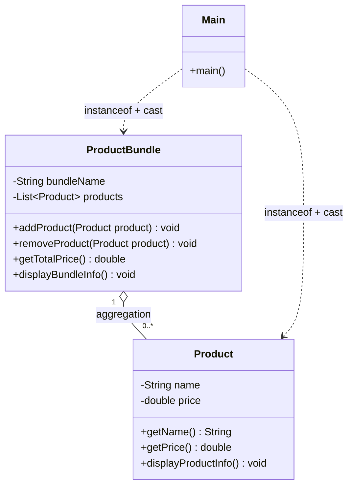
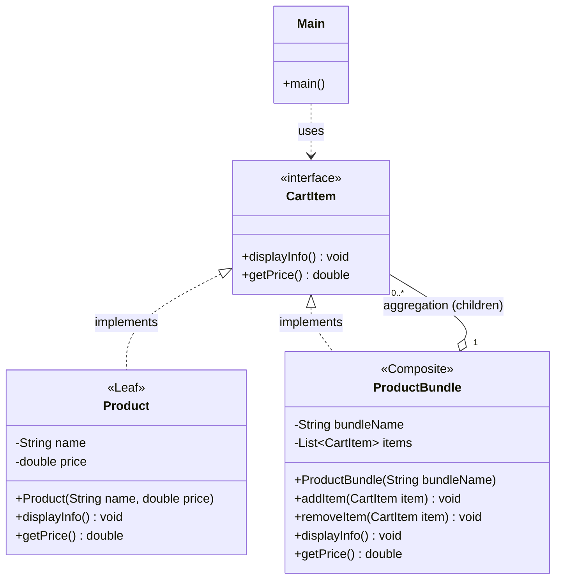

# Composite Pattern - Complete Guide

## What is the Composite Pattern?

The **Composite Pattern** is a structural design pattern that lets you arrange objects into **tree structures** and then treat **individual objects** and **groups of objects** in exactly the same way.

In simpler terms: A single `Product` and a `ProductBundle` (a group of products) share one common interface, so the client can call `getPrice()` or `displayInfo()` on either one **without checking which one it is**.

> Think of folders and files: a folder can contain files *and other folders*, but you can "get size" of either. That "part-whole" tree is the Composite Pattern.

---

## Problem It Solves

### The Problem Without Composite Pattern

A shopping cart can contain **single products** (Book, Pen) and **bundles** (an "Iphone Combo" containing Iphone + Pen + Book). Without a common interface, `Product` and `ProductBundle` are unrelated classes with different method names:

```java
class Product{
    public double getPrice(){ ... }
    public void displayProductInfo(){ ... }
}

class ProductBundle{
    private List<Product> products;
    public double getTotalPrice(){ ... }
    public void displayBundleInfo(){ ... }
}
```

So the cart has to be a `List<Object>`, and the client has to **check the type of every item**:

```java
List<Object> cart = new ArrayList<>();
cart.add(book);
cart.add(pen);
cart.add(iphoneCombo);

for(Object item : cart){
    if(item instanceof Product){
        Product product = (Product) item;
        product.displayProductInfo();
    } else if(item instanceof ProductBundle){
        ProductBundle bundle = (ProductBundle) item;
        bundle.displayBundleInfo();
    }
}
```

**Output:**
```
Composite Pattern
Cart without using composite pattern
Product Name: Book Price: 10.0
Product Name: Pen Price: 2.0
Bundle Name: Iphone Combo
Products in the bundle:
Product Name: Iphone Price: 1000.0
Product Name: Pen Price: 2.0
Product Name: Book Price: 10.0
Total Price: 1012.0
```

**Problems with this approach:**
- **`instanceof` + casting everywhere**: Every place that walks the cart (display, total price, checkout, discounts) repeats the same `if/else` type check
- **`List<Object>` loses type safety**: Anything can be added to the cart (even a `String`) and the compiler won't complain
- **Different method names**: `getPrice()` vs `getTotalPrice()`, `displayProductInfo()` vs `displayBundleInfo()` — the client must remember both
- **No nesting**: `ProductBundle` holds `List<Product>`, so a bundle **can't contain another bundle** (e.g. a "Festive Offer" containing the "Iphone Combo")
- **Violates Open/Closed Principle**: Adding a new item type (e.g. `GiftCard`) means adding another `else if` in every loop

### Solution: Composite Pattern

1. Create a common interface — **`CartItem`** — with `getPrice()` and `displayInfo()`
2. Make **both** `Product` (single item) and `ProductBundle` (group) implement it
3. Let `ProductBundle` hold a **`List<CartItem>`** (not `List<Product>`) so it can contain products **or other bundles**
4. The cart becomes a `List<CartItem>`, and the client just calls `item.getPrice()` — no type checks

---

## Code Structure & Explanation

### 1. CartItem Interface - The Component

```java
interface CartItem{
    void displayInfo();
    double getPrice();
}
```

**What it does:**
- Declares the operations that **both** single items and groups must support
- This is the **Component** in Composite Pattern terms

**Problem solved:** Gives the client one type to work with, so it never needs `instanceof`.

> In the current `Main.java` this interface is named `cartItem` and isn't implemented yet. Java convention is `CartItem` (classes and interfaces start with a capital letter).

---

### 2. Product - The Leaf

```java
class Product implements CartItem{
    private String name;
    private double price;

    public Product(String name, double price){
        this.name = name;
        this.price = price;
    }

    @Override
    public double getPrice(){
        return price;
    }

    @Override
    public void displayInfo(){
        System.out.println("Product Name: "+name+" Price: "+price);
    }
}
```

**What it does:**
- A single, indivisible item — it has **no children**
- Returns its own price and prints its own info
- This is the **Leaf** in Composite Pattern terms (the end of a tree branch)

**Problem solved:** A product now speaks the same "language" (`CartItem`) as a bundle.

---

### 3. ProductBundle - The Composite

```java
class ProductBundle implements CartItem{
    private String bundleName;
    private List<CartItem> items;

    public ProductBundle(String bundleName){
        this.bundleName = bundleName;
        this.items = new ArrayList<>();
    }

    public void addItem(CartItem item){
        items.add(item);
    }

    public void removeItem(CartItem item){
        items.remove(item);
    }

    @Override
    public double getPrice(){
        double totalPrice = 0;
        for(CartItem item : items){
            totalPrice += item.getPrice();
        }
        return totalPrice;
    }

    @Override
    public void displayInfo(){
        System.out.println("Bundle Name: "+bundleName);
        for(CartItem item : items){
            System.out.print("  ");
            item.displayInfo();
        }
        System.out.println("Bundle Total: "+getPrice());
    }
}
```

**What it does:**
- **Implements `CartItem`**: a bundle **is-a** cart item, so it can go into the cart (or into another bundle) like a product
- **Holds `List<CartItem>`**: a bundle **has** cart items — which can be `Product`s **or other `ProductBundle`s**. This one change (from `List<Product>`) is what makes nesting possible
- **`addItem` / `removeItem`**: manage the children
- **`getPrice()` delegates to children**: it asks each child for its price and adds them up. If a child is itself a bundle, that bundle does the same — **recursion** walks the whole tree automatically
- **`displayInfo()` delegates too**: prints its name, then asks each child to print itself

**Problem solved:** Groups behave exactly like single items, and can be nested to any depth.

---

### 4. Usage - Client Treats Everything the Same

```java
void main(){
    System.out.println("Composite Pattern");
    Product book = new Product("Book", 10.0);
    Product pen = new Product("Pen", 2.0);
    Product iphone = new Product("Iphone", 1000.0);

    ProductBundle iphoneCombo = new ProductBundle("Iphone Combo");
    iphoneCombo.addItem(iphone);
    iphoneCombo.addItem(pen);
    iphoneCombo.addItem(book);

    List<CartItem> cart = new ArrayList<>();
    cart.add(book);
    cart.add(pen);
    cart.add(iphoneCombo);

    System.out.println("Cart using composite pattern");
    double total = 0;
    for(CartItem item : cart){
        item.displayInfo();
        total += item.getPrice();
    }
    System.out.println("Cart Total: "+total);
}
```

**What happens step by step:**

1. Three `Product` leaves are created
2. `iphoneCombo` (a composite) gets Iphone, Pen and Book added as children
3. The cart is a `List<CartItem>` holding two leaves and one composite
4. The loop calls `displayInfo()` and `getPrice()` on each item — **no `instanceof`, no casting**
5. For `iphoneCombo`, `getPrice()` internally sums its children: 1000 + 2 + 10 = 1012
6. Cart total = 10 + 2 + 1012 = 1024

**Output:**
```
Composite Pattern
Cart using composite pattern
Product Name: Book Price: 10.0
Product Name: Pen Price: 2.0
Bundle Name: Iphone Combo
  Product Name: Iphone Price: 1000.0
  Product Name: Pen Price: 2.0
  Product Name: Book Price: 10.0
Bundle Total: 1012.0
Cart Total: 1024.0
```

**Nesting for free:** because a bundle holds `CartItem`s, this now works with zero extra code:

```java
ProductBundle festiveOffer = new ProductBundle("Festive Offer");
festiveOffer.addItem(iphoneCombo);   // a bundle inside a bundle
festiveOffer.addItem(new Product("Cover", 5.0));
festiveOffer.getPrice();             // 1012 + 5 = 1017, computed recursively
```

---

## Without vs With Composite

| Aspect | ❌ Without (current `Main.java`) | ✅ With Composite |
|--------|----------------------------------|-------------------|
| Cart type | `List<Object>` | `List<CartItem>` |
| Client loop | `instanceof` + cast for each type | One call: `item.getPrice()` |
| Method names | `getPrice` / `getTotalPrice`, `displayProductInfo` / `displayBundleInfo` | `getPrice`, `displayInfo` for both |
| Bundle holds | `List<Product>` | `List<CartItem>` |
| Bundle inside bundle | ❌ Not possible | ✅ Works automatically |
| Adding `GiftCard` type | Edit every `if/else` loop | Just `implements CartItem` |

---

## Composite Pattern Roles (Mapped to This Code)

| Role | In This Code |
|------|---------------|
| **Component** (common interface) | `CartItem` |
| **Leaf** (single object, no children) | `Product` |
| **Composite** (group, holds children) | `ProductBundle` |
| **Client** (uses only the Component) | `main()` / the cart loop |

---

## Class Diagram

### Before (current `Main.java` — the problem)



The client depends on **both** concrete classes, and the bundle can only hold `Product`s.

### After (Composite Pattern)



### Relationships

| From → To | Relationship | UML Symbol | Why (evidence in code) |
|-----------|--------------|------------|------------------------|
| `Product` → `CartItem` | **Realization** | Dashed line + hollow triangle `- - -▷` | `class Product implements CartItem` |
| `ProductBundle` → `CartItem` | **Realization** ("is-a") | Dashed line + hollow triangle `- - -▷` | `class ProductBundle implements CartItem` — a bundle **is a** cart item |
| `ProductBundle` → `CartItem` | **Aggregation** ("has-many") | Hollow diamond `◇──` on `ProductBundle` side, multiplicity `0..*` | `private List<CartItem> items` — children are **created outside** and passed in with `addItem(...)`. The same `pen` is in the cart *and* in the bundle, so it doesn't belong only to the bundle |
| `Main` → `CartItem` | **Dependency** | Dashed arrow `- - ->` | The cart is a local `List<CartItem>`; the loop only knows the interface |
| *(Before)* `ProductBundle` → `Product` | **Aggregation** | Hollow diamond `◇──` | `private List<Product> products` — tied to the concrete `Product`, so no nesting |

> **The heart of Composite:** `ProductBundle` has **two** lines to `CartItem` — it **is-a** `CartItem` (realization) **and has-many** `CartItem`s (aggregation). That loop back to the interface is what creates the tree. (Decorator has the same shape, but holds **one** child to *add behaviour*; Composite holds **many** children to *build a tree*.)
>
> **Aggregation vs Composition here:** If the bundle created its own products inside its constructor and nobody else could use them, it would be **composition** (filled diamond). Here the products are made in `main()` and shared, so it's **aggregation**.

---

## Advantages

| Advantage | Explanation |
|-----------|-------------|
| **Uniform treatment** | Client calls `getPrice()` on a product or a bundle the same way — no `instanceof` |
| **Nesting for free** | Bundles inside bundles, to any depth, with no extra code |
| **Open/Closed Principle** | New item types (e.g. `GiftCard implements CartItem`) need no changes in client loops |
| **Simpler client code** | One loop over `List<CartItem>` replaces type-checking chains |
| **Recursion does the work** | Totals and display walk the whole tree automatically |

## Disadvantages

| Disadvantage | Explanation |
|--------------|-------------|
| **Overly general interface** | Hard to restrict what goes inside a composite (e.g. "a bundle may not contain a gift card") without runtime checks |
| **Leaf vs composite methods** | `addItem`/`removeItem` only make sense on the composite; putting them in `CartItem` would force `Product` to throw errors, leaving them out means the client sometimes still needs the concrete type |
| **Hidden cost** | `getPrice()` on a deep tree recurses through every node — fine for a cart, slow for huge trees |
| **Cycles** | Nothing stops `bundleA.addItem(bundleB); bundleB.addItem(bundleA);` → infinite recursion (`StackOverflowError`) |

---

## Real-World Applications

- **E-commerce carts**: exactly this example — products, combos, and combos of combos
- **File systems**: `File` (leaf) and `Folder` (composite) both have `getSize()`
- **UI frameworks**: Java Swing/AWT `Container` holds `Component`s; Android `ViewGroup` holds `View`s
- **Organisation charts**: an `Employee` and a `Manager` (who has employees) both have `getSalaryCost()`
- **Menus**: a `MenuItem` and a `Menu` (which holds items and submenus) both have `render()`
- **HTML DOM**: elements contain text nodes and other elements

---

## When to Use Composite Pattern

✅ **Use it when:**
- Your data naturally forms a **tree** (part-whole hierarchy)
- Clients should treat single items and groups the same way
- You see `instanceof` checks to tell "one thing" apart from "a group of things"
- Groups may contain other groups

❌ **Avoid it when:**
- There's no hierarchy — just a flat list of one type
- Leaves and groups behave very differently and can't share a meaningful interface
- You need strict rules about what each group may contain
