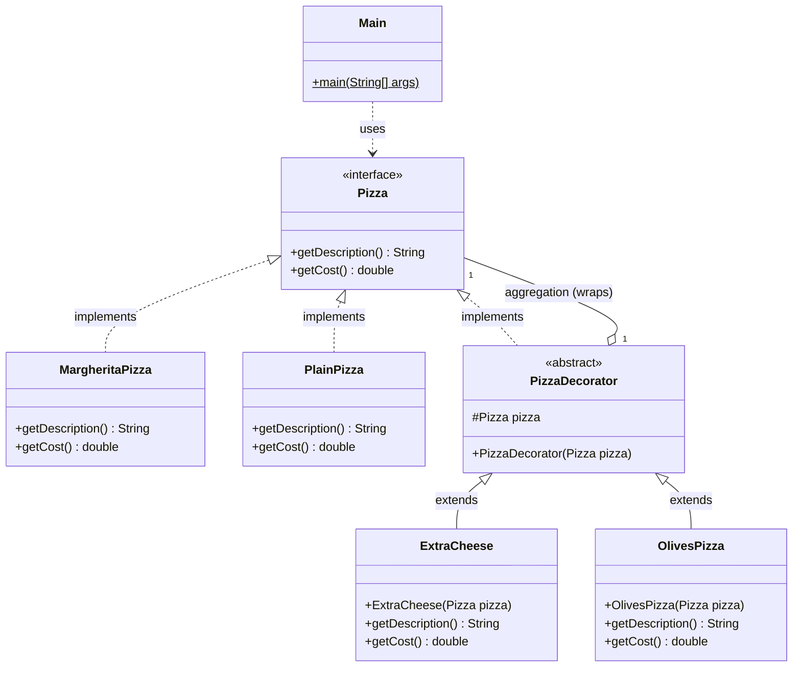

# Decorator Pattern - Complete Guide

## What is the Decorator Pattern?

The **Decorator Pattern** is a structural design pattern that allows you to attach new responsibilities to an object dynamically. It provides a flexible alternative to subclassing for extending functionality.

In simpler terms: It lets you add features to objects without creating new subclasses for every combination of features.

---

## Problem It Solves

### The Problem Without Decorator Pattern

Without the Decorator Pattern, if you have different types of pizzas and various toppings, you would need to create a new class for every combination:

```java
class Pizza{}
class VegPizza extends Pizza{}
class MargheritaPizza extends Pizza{}
class OlivePizza extends MargheritaPizza{}
// ... so on and so forth we can have many types of pizza
// and we can have many types of toppings as well
```

**Problems with this approach:**
- **Class Explosion**: You create a huge number of classes, one for each combination
- **Code Duplication**: Common logic (like topping costs) gets repeated
- **Maintenance Nightmare**: Adding a new topping means modifying multiple classes
- **Rigid Structure**: Hard to add new combinations at runtime

### Solution: Decorator Pattern

Instead of creating classes for every combination, use the Decorator Pattern to **wrap** objects and add functionality dynamically.

---

## Code Structure & Explanation

### 1. Pizza Interface - The Component

```java
interface Pizza{
    String getDescription();
    double getCost();
}
```

**What it does:**
- Defines the contract that all pizzas must follow
- Two methods: get description and get cost

**Problem solved:** Ensures a consistent interface for all components (base pizzas and decorated pizzas), so decorators and concrete pizzas can be used interchangeably.

---

### 2. Concrete Components - Base Pizzas

#### MargheritaPizza

```java
class MargheritaPizza implements Pizza{
    @Override
    public String getDescription(){
        return "Margerita Pizzza";
    }

    @Override
    public double getCost(){
        return 199.0;
    }
}
```

**What it does:**
- Implements the Pizza interface
- Defines a basic Margherita pizza with fixed cost and description
- This is a **concrete component** - the base object that can be decorated

**Problem solved:** Provides a starting point object that decorators can wrap around.

---

#### PlainPizza

```java
class PlainPizza implements Pizza{
    @Override
    public String getDescription(){
        return "Plain Pizza";
    }

    @Override
    public double getCost(){
        return 78.4;
    }
}
```

**What it does:**
- Another concrete component - a simpler pizza option
- Shows that you can have multiple base objects to decorate

**Problem solved:** Demonstrates that the same decorators work with any pizza type, not just one.

---

### 3. Abstract Decorator - The Wrapper

```java
abstract class PizzaDecorator implements Pizza{
    protected Pizza pizza;
    
    public PizzaDecorator(Pizza pizza){
        this.pizza = pizza;
    }
}
```

**What it does:**
- **Implements Pizza interface**: Makes it compatible with the component it decorates, so a decorated pizza is still a `Pizza`
- **Holds reference to Pizza**: `protected Pizza pizza` - wraps any Pizza object (a base pizza OR another decorator)
- **Constructor accepts Pizza**: Takes a Pizza object and stores it for wrapping
- **Doesn't implement interface methods**: Left abstract so concrete decorators are forced to implement them

**Why `pizza` must be `protected`, not `private`:**
- Concrete decorator subclasses (like `ExtraCheese`) need direct access to `pizza` to call `pizza.getDescription()` / `pizza.getCost()` and build on top of it
- If it were `private`, subclasses couldn't access it directly

**Why the abstract class doesn't implement `getDescription()`/`getCost()` itself:**
- If it did, every concrete decorator would inherit that single fixed behavior and couldn't override it meaningfully
- Each decorator needs its own version to add its own specific behavior (e.g., adding cheese cost vs olive cost)

**Problem solved:** Provides the shared base structure for all decorators - they all wrap a Pizza and are responsible for adding their own behavior on top.

---

### 4. Concrete Decorators - Actual Toppings

#### ExtraCheese Decorator

```java
class ExtraCheese extends PizzaDecorator{
    public ExtraCheese(Pizza pizza){
        super(pizza);  // Calls parent constructor, stores the wrapped pizza
    }

    @Override
    public String getDescription(){
        return pizza.getDescription() + " + Extra Cheese";
    }

    @Override
    public double getCost(){
        return pizza.getCost() + 12.0;  // Adds topping cost
    }
}
```

**What it does:**
- **Wraps a Pizza object**: Can decorate any Pizza (a base pizza or an already-decorated one)
- **Adds to description**: Concatenates " + Extra Cheese" to the wrapped pizza's description
- **Adds to cost**: Adds 12.0 to the wrapped pizza's cost

**How it works:**
1. Receives a Pizza object in constructor
2. Stores it as `protected Pizza pizza` (inherited from parent)
3. When `getDescription()` is called, it calls the wrapped pizza's description and appends its own text
4. When `getCost()` is called, it calls the wrapped pizza's cost and adds the topping's own cost

**Problem solved:** Adds "Extra Cheese" functionality without creating separate `MargheritaPizzaWithCheese` or `PlainPizzaWithCheese` classes.

---

#### OlivesPizza Decorator

```java
class OlivesPizza extends PizzaDecorator{
    public OlivesPizza(Pizza pizza){
        super(pizza);
    }

    @Override
    public String getDescription(){
        return pizza.getDescription() + " + Olivea";
    }

    @Override
    public double getCost(){
        return pizza.getCost() + 12.3;
    }
}
```

**What it does:**
- Same pattern as `ExtraCheese` but for olives
- Adds " + Olivea" to the description and 12.3 to the cost

**Problem solved:** Another independent topping that can be freely combined with any pizza or with other decorators.

---

### 5. Usage - Dynamic Composition

#### Example 1: Margherita Pizza with Olives and Extra Cheese

```java
Pizza pizza = new ExtraCheese(new OlivesPizza(new MargheritaPizza()));

System.out.println(pizza.getDescription());
System.out.println(pizza.getCost());
```

**What happens, step by step:**

1. `new MargheritaPizza()` → base pizza (description: "Margerita Pizzza", cost: 199.0)
2. `new OlivesPizza(...)` → wraps it with the olives decorator
   - description: "Margerita Pizzza + Olivea"
   - cost: 199.0 + 12.3 = 211.3
3. `new ExtraCheese(...)` → wraps the already-decorated pizza with the cheese decorator
   - description: "Margerita Pizzza + Olivea + Extra Cheese"
   - cost: 211.3 + 12.0 = 223.3

**Output:**
```
Margerita Pizzza + Olivea + Extra Cheese
223.3
```

**Problem solved:** Toppings can be combined in any order and nested arbitrarily, without ever creating a `MargheritaPizzaWithOlivesAndCheese` class.

---

#### Example 2: Plain Pizza with Olives and Extra Cheese

```java
Pizza pizza1 = new ExtraCheese(new OlivesPizza(new PlainPizza()));

System.out.println(pizza1.getDescription());
System.out.println(pizza1.getCost());
```

**What happens:**

1. `new PlainPizza()` → base pizza (cost: 78.4)
2. `new OlivesPizza(...)` → adds olives
   - description: "Plain Pizza + Olivea"
   - cost: 78.4 + 12.3 = 90.7
3. `new ExtraCheese(...)` → adds cheese
   - description: "Plain Pizza + Olivea + Extra Cheese"
   - cost: 90.7 + 12.0 = 102.7

**Output:**
```
Plain Pizza + Olivea + Extra Cheese
102.7
```

**Problem solved:** The exact same decorator classes (`ExtraCheese`, `OlivesPizza`) are reused on a completely different base pizza - proving the decorators are independent of the concrete component they wrap.

---

## Decorator Pattern Roles (Mapped to This Code)

| Role | In This Code |
|------|---------------|
| **Component** (common interface) | `Pizza` |
| **Concrete Components** (base objects) | `MargheritaPizza`, `PlainPizza` |
| **Decorator** (abstract wrapper) | `PizzaDecorator` |
| **Concrete Decorators** (add behaviour) | `ExtraCheese`, `OlivesPizza` |

---

## Class Diagram



### Relationships

| From → To | Relationship | UML Symbol | Why (evidence in code) |
|-----------|--------------|------------|------------------------|
| `MargheritaPizza`, `PlainPizza` → `Pizza` | **Realization** | Dashed line + hollow triangle `- - -▷` | `class MargheritaPizza implements Pizza` |
| `PizzaDecorator` → `Pizza` | **Realization** ("is-a") | Dashed line + hollow triangle `- - -▷` | `abstract class PizzaDecorator implements Pizza` — a decorated pizza **is still a** `Pizza` |
| `ExtraCheese`, `OlivesPizza` → `PizzaDecorator` | **Inheritance / Generalization** | Solid line + hollow triangle `───▷` | `class ExtraCheese extends PizzaDecorator` |
| `PizzaDecorator` → `Pizza` | **Aggregation** ("has-a") | Hollow diamond `◇──` on `PizzaDecorator` side | `protected Pizza pizza` is **passed in through the constructor** — created outside and handed in, e.g. `new ExtraCheese(new OlivesPizza(...))` |
| `Main` → `Pizza` and concrete classes | **Dependency** | Dashed arrow `- - ->` | Objects are only created as local variables in `main()` |

> **The heart of Decorator:** `PizzaDecorator` has **two** lines to `Pizza` at the same time — it **is-a** `Pizza` (realization) **and has-a** `Pizza` (aggregation). That's what lets decorators wrap each other in any order: `ExtraCheese → OlivesPizza → MargheritaPizza`.

---

## Key Benefits of Decorator Pattern

| Benefit | Example from this code |
|---------|-------------------------|
| **Flexible Composition** | Build a pizza with any combination of toppings at runtime |
| **No Class Explosion** | 2 base pizzas + 2 toppings = 4+ combinations, with no extra classes needed per combination |
| **Easy to Add Features** | Add a new topping by creating one new `PizzaDecorator` subclass |
| **Single Responsibility** | Each decorator focuses on one thing (`ExtraCheese` only knows about cheese) |
| **Runtime Flexibility** | Decide which toppings to wrap around a pizza based on user choice, not compile-time class selection |

## Disadvantages

| Disadvantage | Explanation |
|--------------|-------------|
| **Many small classes** | Every topping is its own class, so large menus mean many tiny classes |
| **Hard to debug** | `new ExtraCheese(new OlivesPizza(new MargheritaPizza()))` — a deep chain is hard to step through |
| **Order can matter** | When decorators change behaviour (not just add cost), wrapping order changes the result |
| **Hard to remove a layer** | Once wrapped, you can't easily take out a middle topping without rebuilding the chain |
| **Identity checks break** | A decorated pizza is a different object, so `instanceof MargheritaPizza` returns false |

---

## Real-World Applications

- **Java I/O**: `FileInputStream` wrapped with `BufferedInputStream`, `DataInputStream`, etc.
- **UI Components**: Adding borders, scrollbars, shadows to UI elements
- **Feature Toggles**: Adding logging, caching, security checks around existing methods
- **Text Processing**: Adding formatters, validators, encryptors around a text stream

---

## When to Use Decorator Pattern

✅ **Use it when:**
- You need to add responsibilities to objects dynamically, at runtime
- You have many possible combinations of features (toppings, in this example)
- You want to avoid class explosion from deep/wide inheritance hierarchies
- You need to add and remove features independently of each other

❌ **Avoid it when:**
- You have only a few fixed, known combinations (plain subclassing may be simpler)
- The wrapping/unwrapping adds unnecessary indirection for a simple case
- Debugging deeply nested decorator chains becomes hard to reason about
