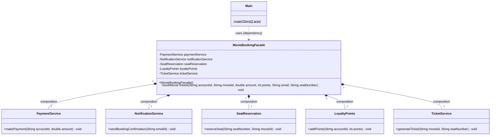

# Facade Pattern - Complete Guide

## What is the Facade Pattern?

The **Facade Pattern** is a structural design pattern that provides a **single, simplified interface** to a complex subsystem made up of many classes. The client talks to one "front desk" class (the facade), and the facade coordinates all the subsystem classes behind the scenes.

In simpler terms: Instead of the client calling 5 different services in the right order with the right arguments, it calls **one method** on the facade, and the facade does all that work for it.

> *Facade* (pronounced "fa-saad") literally means the front face of a building — you see one clean front, not the plumbing and wiring behind it.

---

## Problem It Solves

### The Problem Without Facade Pattern

Booking a movie ticket (like BookMyShow) needs several independent services:

```java
class PaymentService{ ... }       // charge the user
class NotificationService{ ... }  // send booking confirmation
class SeatReservation{ ... }      // lock the seat
class LoyaltyPoints{ ... }        // add reward points
class TicketService{ ... }        // generate the ticket
```

Without a facade, **every client** that wants to book a ticket has to do this itself:

```java
public static void main(String[] args){
    PaymentService paymentService = new PaymentService();
    NotificationService notificationService = new NotificationService();
    SeatReservation seatReservation = new SeatReservation();
    LoyaltyPoints loyaltyPoints = new LoyaltyPoints();
    TicketService ticketService = new TicketService();

    paymentService.makePayment("123", 345.23);
    notificationService.sendBookingConfirmation("abs@gmail.com");
    seatReservation.reserveSeat("A23", "Old Gaurd");
    loyaltyPoints.addPoints("123", 24);
    ticketService.generateTicket("Old Gaurd", "A23");
}
```

**Problems with this approach:**
- **Tight coupling**: The client depends on **5 concrete classes** instead of 1
- **Client must know the workflow**: Which services to call, in what order, with which arguments
- **Duplicated logic**: Mobile app, website and kiosk would all repeat this same sequence
- **Hard to change**: Adding a new step (e.g. `CouponService`) means editing every client

### Solution: Facade Pattern

Create one `MovieBookingFacade` class that owns all the subsystem services and exposes a single method — `bookMovieTickets(...)`. The client calls only that method.

---

## Code Structure & Explanation

### 1. Subsystem Classes - The Complex Parts

```java
class PaymentService{
    public void makePayment(String accountId, double amount){
        System.out.println("Paid ₹ "+amount+" on account no. "+accountId);
        System.out.println();
    }
}

class NotificationService{
    public void sendBookingConfirmation(String emailId){
        System.out.println("Ticket booking is confirmed for email : "+emailId);
    }
}

class SeatReservation{
    public void reserveSeat(String seatNumber, String movieId){
        System.out.println("Your seat number is: "+seatNumber+ " for movieId "+movieId);
        System.out.println();
    }
}

class LoyaltyPoints{
    public void addPoints(String accountId, int points){
        System.out.println("Add points on account Id "+accountId+ " with points " + points);
    }
}

class TicketService{
    public void generateTicket(String movieId, String seatNumber){
        System.out.println("Your movie is "+movieId+" and your seat Number is "+seatNumber);
    }
}
```

**What it does:**
- Each class does **one job** (Single Responsibility Principle)
- These are the **Subsystem** classes in Facade Pattern terms
- They **don't know the facade exists** — they can still be used directly if needed

**Problem solved:** Nothing yet — on their own, these classes ARE the complexity the client would otherwise have to manage.

---

### 2. MovieBookingFacade - The Facade

```java
class MovieBookingFacade{
    private PaymentService paymentService;
    private NotificationService notificationService;
    private SeatReservation seatReservation;
    private LoyaltyPoints loyaltyPoints;
    private TicketService ticketService;

    public MovieBookingFacade(){
        this.paymentService = new PaymentService();
        this.notificationService = new NotificationService();
        this.seatReservation = new SeatReservation();
        this.loyaltyPoints = new LoyaltyPoints();
        this.ticketService = new TicketService();
    }

    public void bookMovieTickets(String accountId, String movieId, double amount, int points, String email, String seatNumber){
        paymentService.makePayment(accountId, amount);
        notificationService.sendBookingConfirmation(email);
        seatReservation.reserveSeat(seatNumber, movieId);
        loyaltyPoints.addPoints(accountId, points);
        ticketService.generateTicket(movieId, seatNumber);
        System.out.println();
        System.out.println("Congrates booking is successful");
    }
}
```

**What it does:**
- **Holds all subsystem objects as `private` fields**: The client can't reach them through the facade — they're an internal detail
- **Constructor creates the subsystems**: `new PaymentService()`, etc. — the facade owns them, so their lifetime is tied to the facade (this is **composition**)
- **One high-level method**: `bookMovieTickets(...)` contains the entire booking workflow — which services are called, in what order, with which arguments
- **Adds no new business logic of its own**: It only **delegates and coordinates**. The real work stays in the subsystem classes

**Problem solved:** The booking workflow now lives in exactly one place. Every client reuses it, and changing the workflow means editing only this class.

> **Design note:** In real systems the order matters — you'd normally `reserveSeat` → `makePayment` → `generateTicket` → `addPoints` → `sendBookingConfirmation`, so a user is never charged for a seat someone else took. That is exactly the kind of knowledge the facade should hide from the client.

---

### 3. Main - The Client

```java
public class Main{
    public static void main(String[] args){
        System.out.println("Facade Pattern");

        MovieBookingFacade movieBookingFacade = new MovieBookingFacade();
        movieBookingFacade.bookMovieTickets("123", "Old Gaurd", 345.23, 24, "abs@gmail.com", "A23");
    }
}
```

**What happens step by step:**

1. `new MovieBookingFacade()` → the facade's constructor creates all 5 subsystem objects
2. `bookMovieTickets(...)` → the client makes **one call**
3. Inside, the facade calls `makePayment` → `sendBookingConfirmation` → `reserveSeat` → `addPoints` → `generateTicket`
4. The facade prints the final success message

**Output:**
```
Facade Pattern
Paid ₹ 345.23 on account no. 123

Ticket booking is confirmed for email : abs@gmail.com
Your seat number is: A23 for movieId Old Gaurd

Add points on account Id 123 with points 24
Your movie is Old Gaurd and your seat Number is A23

Congrates booking is successful
```

**Problem solved:** `Main` depends on just **one** class (`MovieBookingFacade`) instead of five, and doesn't need to know anything about the booking workflow.

---

## Facade Pattern Roles (Mapped to This Code)

| Role | In This Code |
|------|---------------|
| **Facade** (simplified entry point) | `MovieBookingFacade` |
| **Subsystem classes** (do the real work) | `PaymentService`, `NotificationService`, `SeatReservation`, `LoyaltyPoints`, `TicketService` |
| **Client** (uses only the facade) | `Main` |

---

## Class Diagram



### Relationships

| From → To | Relationship | UML Symbol | Why (evidence in code) |
|-----------|--------------|------------|------------------------|
| `MovieBookingFacade` → `PaymentService`, `NotificationService`, `SeatReservation`, `LoyaltyPoints`, `TicketService` | **Composition** (strong "has-a") | Filled diamond `◆──` on the facade side | Each is a `private` field **created inside the facade's constructor** with `new`. Nobody else holds a reference, so when the facade is destroyed, its subsystems go with it |
| `Main` → `MovieBookingFacade` | **Dependency** ("uses-a") | Dashed arrow `- - ->` | `Main` only uses the facade as a **local variable** inside `main()`; it doesn't keep it as a field |
| Subsystems → `MovieBookingFacade` | **None** | — | Subsystems have no reference back to the facade. The relationship is **one-directional** |

> **Composition vs Aggregation here:** If the facade received the services through its constructor instead (e.g. `new MovieBookingFacade(paymentService, ...)`), they could exist outside the facade and be shared. That would make it **aggregation** (hollow diamond `◇──`). Both versions are valid; injection is easier to unit-test.

---

## Advantages

| Advantage | Explanation |
|-----------|-------------|
| **Simple client code** | One call `bookMovieTickets(...)` instead of creating and calling 5 services |
| **Loose coupling** | Client depends on 1 class instead of 5; subsystem changes don't ripple to clients |
| **Workflow in one place** | Order and rules of booking live in the facade, not duplicated in every client |
| **Easier to evolve** | Adding `CouponService` changes only the facade |
| **Layering** | Gives a clean entry point to a subsystem (common in service/API layers) |
| **Subsystem still accessible** | Advanced clients can still use the subsystem classes directly if they need to |

## Disadvantages

| Disadvantage | Explanation |
|--------------|-------------|
| **God object risk** | If every new feature is added to the facade, it grows into a huge class that knows everything |
| **Less flexibility** | Clients only get what the facade exposes; fine-grained control needs direct subsystem access |
| **Extra layer** | One more class to maintain; overkill if the subsystem is already simple |
| **Hidden coupling** | The facade itself is tightly coupled to all subsystem classes (unless they're injected) |

---

## Facade vs Adapter vs Decorator

| Aspect | Facade | Adapter | Decorator |
|--------|--------|---------|-----------|
| **Intent** | Simplify a complex subsystem | Make an incompatible interface fit | Add behaviour without subclassing |
| **Wraps** | **Many** objects | **One** object | **One** object (can be chained) |
| **Interface** | Defines a **new, simpler** interface | Converts to an **existing expected** interface | Keeps the **same** interface |
| **Example in this repo** | `MovieBookingFacade` | `Razorpay` wrapping `RazorpayApi` | `ExtraCheese` wrapping a `Pizza` |

---

## Real-World Applications

- **Movie / travel booking**: exactly this example — one `book()` call coordinates payment, seats, tickets, and notifications
- **E-commerce checkout**: `OrderFacade.placeOrder()` → inventory, payment, shipping, invoice, email
- **Spring `JdbcTemplate`**: hides connection, statement, result-set and exception handling behind simple methods
- **SLF4J**: a simple logging facade over Logback, Log4j, java.util.logging
- **Home theatre / smart-home apps**: one `watchMovie()` button turns on the TV, dims lights, starts the sound system
- **Service layer in backend apps**: a controller calls one service method that orchestrates multiple repositories and clients

---

## When to Use Facade Pattern

✅ **Use it when:**
- A subsystem has many classes and clients only need a few common workflows
- Several clients repeat the same sequence of calls
- You want to decouple clients from subsystem classes so the subsystem can change freely
- You want a clear entry point into a layer (e.g. a service layer)

❌ **Avoid it when:**
- The subsystem is already simple (1–2 classes) — the facade adds nothing
- Clients genuinely need fine-grained control over every subsystem step
- The facade starts collecting unrelated responsibilities — split it into several smaller facades instead
